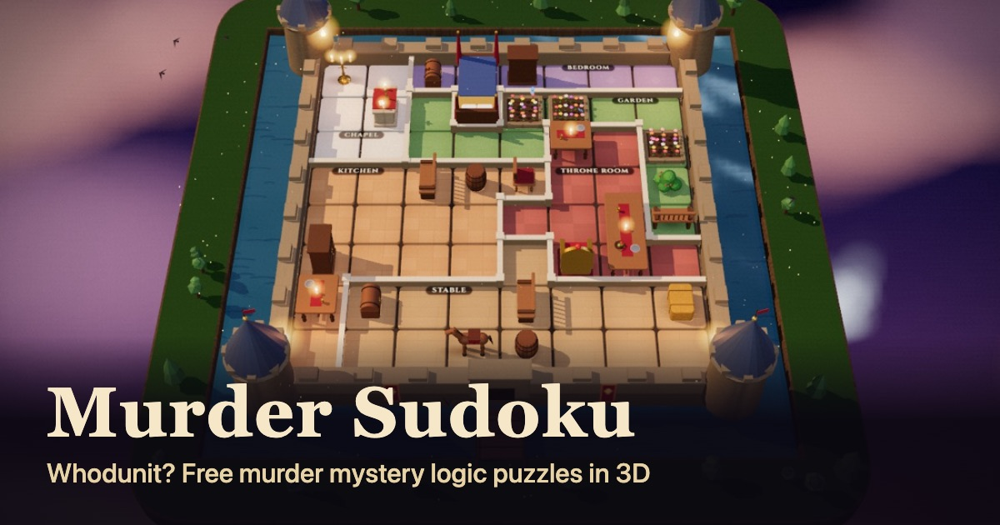

# Murder Sudoku

**Whodunit?** Murder Sudoku is a free murder mystery logic puzzle in your browser. Place the suspects on the floor plan, follow their clues, and unmask the killer.

**[Play now](https://jeroenmarchand.github.io/murder-sudoku/)** · [3D](https://jeroenmarchand.github.io/murder-sudoku/3d/) · [Classic and printable](https://jeroenmarchand.github.io/murder-sudoku/classic/) · [Nederlands](https://jeroenmarchand.github.io/murder-sudoku/nl/)



- Endless cases, each with exactly one solution
- Three levels (6×6, 8×8, and 9×9) and six 3D settings
- Works on phone, tablet, and computer, with no account and no ads
- Printable version with the solution on a separate page
- Available in English and Dutch, and open to more languages

## How to play

Every suspect gets their own row and column, like sudoku. Each suspect has a clue, such as "Sat on a chair, in the kitchen." The killer is the one person who was alone in a room with the victim.

## Contribute

Everyone can help, with or without programming experience:

- **Send feedback:** in the game, open the menu with the three dots and choose **Feedback**. The dialog fills in a GitHub issue for you, including the case number. You need a free GitHub account to submit it.
- **Pick up an issue:** look for the [`good first issue`](https://github.com/jeroenmarchand/murder-sudoku/labels/good%20first%20issue) label.
- **Add a language:** see [Translations](CONTRIBUTING.md#translations).
- **Build a new 3D setting:** follow [docs/THEMES.md](docs/THEMES.md). One file per setting.

### Quick start

You need [Node.js](https://nodejs.org) 20 or later.

```sh
git clone https://github.com/jeroenmarchand/murder-sudoku
cd murder-sudoku
npm install
npm run dev     # open http://localhost:5173
npm test        # builds the site and runs all tests
```

Prefer not to install anything? Click **Code → Codespaces → Create codespace** and everything is ready.

### Work with an AI agent

The repository is set up for coding agents such as Claude Code, Codex, Copilot, and Cursor. [AGENTS.md](AGENTS.md) describes the layout, the commands, and the rules. Give your agent an issue, let it run `npm test`, and open a pull request. Read [CONTRIBUTING.md](CONTRIBUTING.md) for the workflow.

## How it fits together

| Path | Contents |
|---|---|
| `src/core.js` | Puzzle generator and solver, shared by both versions |
| `src/3d/` | The 3D version (three.js), one file per setting in `themes/`, text per language in `i18n/` |
| `src/classic/` | The classic 2D version with printing, text per language in `i18n/` |
| `src/site/` | Landing pages (English at the root, other languages in a folder per language), images, and static files |
| `src/shared/feedback.js` | The feedback dialog that prefills a GitHub issue |
| `scripts/` | Build (`build.mjs`), dev server, and screenshots |
| `tests/` | Generator tests, smoke tests per page, language, and setting, and a full play-through |

There is no framework and no bundler, and no server: `npm run build` combines the files into static HTML in `dist/`, once per language. Every push to `main` is published to GitHub Pages after the tests pass.

## License

[PolyForm Noncommercial 1.0.0](LICENSE): free for noncommercial use. Jeroen Marchand holds the copyright and can offer commercial licenses. Murder Sudoku is an independent project. All puzzles come from its own generator.
